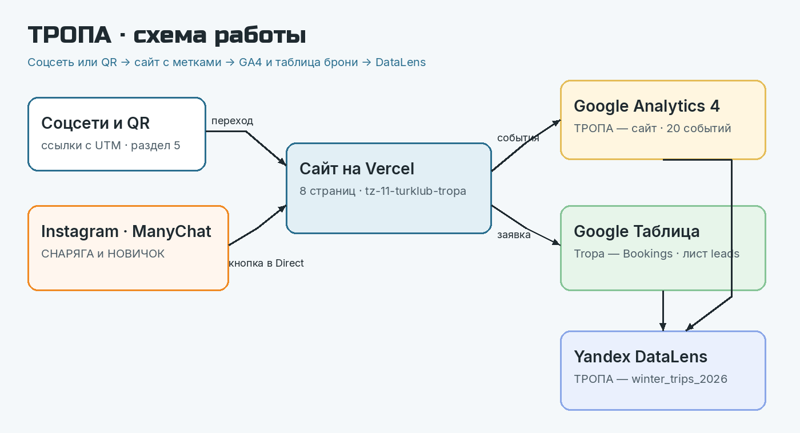

# Турклуб «Тропа» — сайт и сквозная аналитика броней

Курсовая работа по дисциплине ОП.03 «Информационные технологии», ТЗ № 11/2026.
Исполнитель: Марущак Сергей Григорьевич, группа РПО25/2.

Сайт зимних походов: посетитель приходит по ссылке с меткой, бронь падает в Google Таблицу, а события — в GA4. Руководитель потом видит на дашборде DataLens, какой канал приводит людей.



## Ссылки

| Что | Ссылка |
|---|---|
| Сайт | https://tz-11-turklub-tropa.vercel.app |
| Таблица заявок | подключается исполнителем, шаги в [docs/podklyuchenie.md](docs/podklyuchenie.md) |
| Дашборд DataLens | после выгрузки GA4, состав вкладок в [docs/datalens.md](docs/datalens.md) |
| Instagram и Reel с автоответом | тексты веток в [docs/manychat.md](docs/manychat.md), аккаунт `tropa_hiking` создаёт исполнитель |
| ВКонтакте · Telegram · YouTube | публикации по реестру [docs/utm.csv](docs/utm.csv) |
| Описание работы | [docs/opisanie.md](docs/opisanie.md) |
| Презентация к защите | [presentation/zashchita.pdf](presentation/zashchita.pdf) |
| Исходник слайдов | [presentation/zashchita.html](presentation/zashchita.html) |

Ресурс GA4: `G-XXXXXXXXXX`. Это заглушка в `<head>` всех страниц. Её меняют на Measurement ID ресурса «ТРОПА — сайт». Доступ Viewer к ресурсу GA4 выдан: после создания ресурса, на почту заказчика.

Пока проект не импортирован в Vercel, сайт открывается локально: из корня репозитория `python3 -m http.server` и адрес `http://127.0.0.1:8000`. На Vercel адрес выше появится после импорта этого репозитория, ветка `main`.

## Что сделано

| Часть | Результат |
|---|---|
| Сайт | 8 страниц и `404.html`, статический HTML, Lighthouse mobile: 99 / 100 / 100 |
| GA4 | 20 событий в `js/analytics.js`, ключевые: `generate_lead`, `contact_click`, `messenger_click` |
| UTM | 12 ссылок в реестре, QR на афише `docs/afisha.pdf` |
| Заявки | форма → Apps Script → лист `leads`, проверка полей и повторов |
| Instagram | тексты двух веток: `СНАРЯГА` и `НОВИЧОК` |
| Отчёты | схема дашборда и бланк записки, числа заполняются из своих отчётов |

## Технологии

HTML, CSS, JavaScript · Google Analytics 4 · Google Таблицы и Apps Script · ManyChat · Yandex DataLens · GitHub и Vercel. Сайт собран в Cursor (запросы — в [docs/prompts.md](docs/prompts.md)).

## Структура

```text
index.html …         страницы сайта
js/analytics.js      все события GA4
js/config.js         сюда вставляется URL приёмника заявок
apps-script/Code.gs  приёмник заявок
docs/                описание, реестр UTM, события, записка, схема
screens/             кадры сайта и список кадров, которые снимаются в кабинетах
presentation/        презентация к защите
```

## Итог

Не получилось: ресурс GA4, таблица, короткие ссылки vk.cc и clck.ru, публикации в четырёх соцсетях, ManyChat Live и дашборд DataLens. Для них нужны аккаунты исполнителя. Код сайта, события, приёмник, реестр и афиша готовы, куда вставлять идентификаторы написано в `docs/podklyuchenie.md`.

Нейросеть использовалась для: вёрстки страниц, текстов по сведениям ТЗ, кода событий и Apps Script, схемы и презентации. Километраж, биографии инструкторов и числа отчётов вручную не выдумывались.
