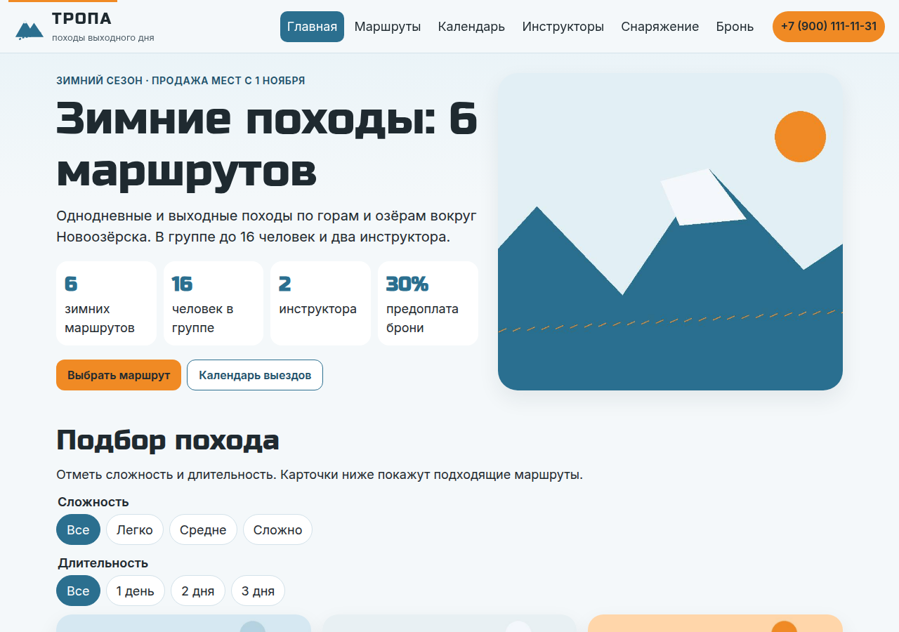
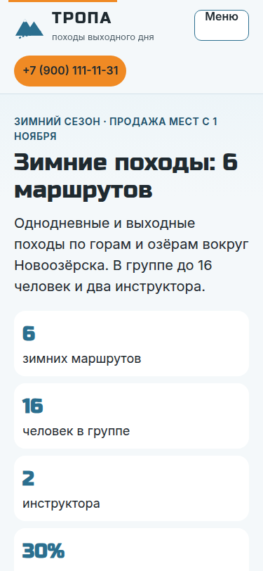
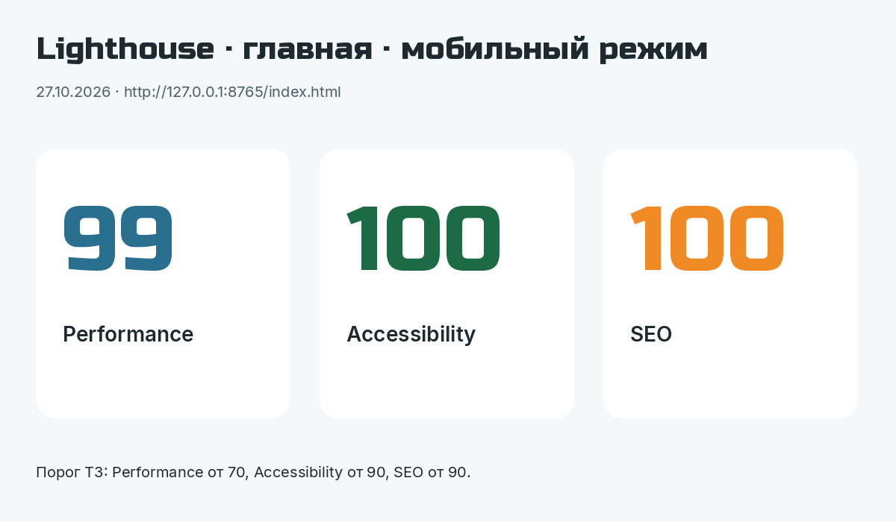
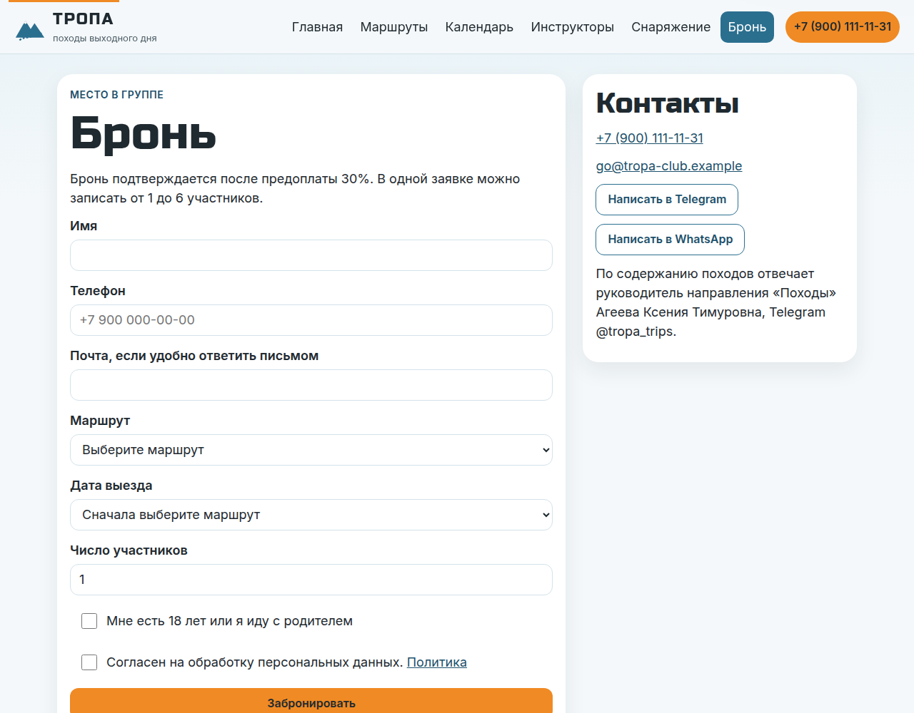

# Описание работы · ТЗ № 11/2026 · «Тропа»

**Исполнитель:** Марущак Сергей Григорьевич, группа РПО25/2
**Сайт:** https://tz-11-turklub-tropa.vercel.app
**Период проверок:** код сайта собран 27.10.2026. Проверки в GA4, таблице и соцсетях начинаются после подключения кабинетов.

## 1. Задача заказчика

Компания «Тропа» получает заявки из Instagram и ВКонтакте, но не знает, какой канал приводит людей. В сентябре 2026 года 58 человек написали в группы, где мест уже не было, и другую дату им не предложили. Задача — сайт, на котором видно источник каждого посетителя, и одна таблица со всеми бронями.

## 2. Схема работы

Посетитель приходит из соцсетей или по QR-коду в магазине снаряжения по ссылке с UTM-метками. Сайт отправляет события в GA4, а бронь — в Google Таблицу «Tropa — Bookings» через Apps Script. Данные GA4 и таблицы собираются на дашборде DataLens «ТРОПА — winter_trips_2026».

## 3. Сайт

Сайт из 8 страниц и `404.html` собран в Cursor и доработан вручную: календарь показывает «Мест нет» и ближайшую другую дату, калькулятор аренды считает по ценам ТЗ, `generate_lead` ждёт ответ приёмника. Опубликовать его нужно на Vercel, дальше сайт обновляется после каждого push в `main`.

Локальная проверка Lighthouse для главной в мобильном режиме 27.10.2026: Performance 99, Accessibility 100, SEO 100.

## 4. Аналитика GA4

В коде 20 событий, из них свои, не из расширенной статистики, — 14, включая `generate_lead`. Два события по выбору: `promo_copy` и `map_open`. Ключевые: `generate_lead`, `contact_click`, `messenger_click`.

Ресурс «ТРОПА — сайт», идентификатор `G-3R2JCQ7P84`. Тег стоит в `<head>` всех страниц. Снимки DebugView и пользовательские параметры исполнитель добавляет сам, список — в `podklyuchenie.md`. Кадры кладутся в `screens/ga4/` под именем события.

## 5. UTM-ссылки и соцсети

В реестре 12 ссылок. Пустые ячейки ТЗ заполнены по правилам раздела 5.1, объяснение — в `utm.md`. QR строки U-12 лежит в `qr-u-12.png`, афиша — `afisha.pdf`.

Публикации в Instagram, ВКонтакте, Telegram и YouTube и короткие ссылки vk.cc / clck.ru делает исполнитель уже из готовых адресов. Ники блогеров `partner_1` и `partner_2` перед публикацией меняются на латинские ники двух студентов группы.

## 6. Заявки

Форма отправляет бронь в Apps Script. Приёмник проверяет поля и пишет строку в лист `leads` вместе с метками. Повторная отправка с тем же `request_id` вторую строку не создаёт. `status` из браузера не принимается, приёмник ставит `new`.

Адрес веб-приложения записан в `js/config.js`. Форма отправляет заявку на него и показывает «заявка ушла» только после ответа `ok: true`.

Кадр строки в таблице появится в `screens/kursovaya/` после первой настоящей заявки.

## 7. Автоответы в Instagram

Комментарий «СНАРЯГА» под Reel «Ночёвка в палатке при −15 °C» запускает ответ в комментариях и сообщение в Direct с кнопкой на чек-лист, ссылка U-02. Вторая ветка — слово «НОВИЧОК», кнопка ведёт на лёгкие маршруты, ссылка U-03.

Тексты для копирования в ManyChat — в `manychat.md`. Кадры `screens/instagram/comment-reply.png` и `screens/instagram/dm-button.png` снимаются, когда автоматизация стоит в Live.

## 8. Отчёты и дашборд

Воронка в коде задана так: `page_view` → `trip_filter` → `cta_click` → `form_start` → `generate_lead`. Где теряется больше всего людей, станет видно после проверок. Числа в `report.md` специально не заполнены.

Состав дашборда и формулы, включая статус `went` вместо учебного `done`, — в `datalens.md`.

## 9. Что получил бизнес

| Было | Стало |
|---|---|
| заявки в личных сообщениях | форма пишет все брони в один лист со статусом |
| источник клиента неизвестен | у заявки есть source, medium, campaign и content |
| человек не узнаёт другую дату | на календаре у полного выезда есть ближайшая дата того же маршрута |
| «что взять» отвечают вручную | чек-лист, PDF и автоответ ManyChat ведут на одну страницу |

Рекомендация заказчику: когда появятся первые брони, сравнить каналы по числу статуса `prepaid` и следующий пост ставить в канал, где предоплат больше.

## 10. Итог

Не получилось: подключить GA4, таблицу, соцсети, ManyChat и DataLens из этого окружения. Аккаунты остаются у исполнителя, шаги расписаны.
ИИ использовался для: страниц, текстов по ТЗ, событий, Apps Script, схемы и презентации.
